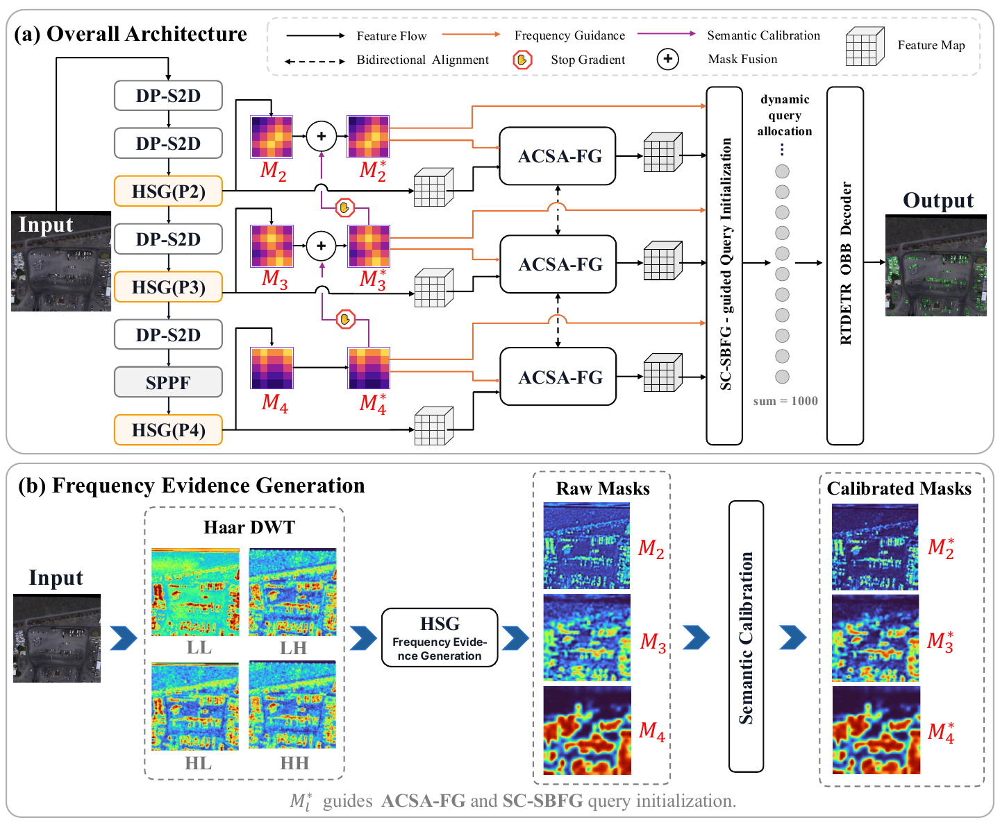
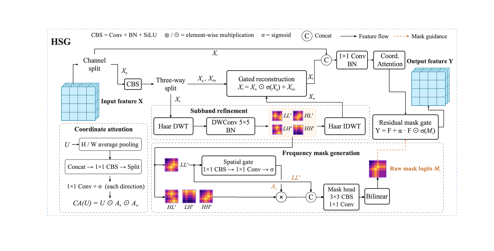

# FMC-Wave-DETR

**Cross-Stage Frequency-Guided Learning for Oriented Tiny Object Detection in Remote Sensing Images**

**Authors:** JianHong Zhang, LieJun Wang, and Feng Yan  
**Affiliation:** School of Computer Science and Technology, Xinjiang University, Urumqi, China  
**Repository:** [MVTC-Lab/FMC-Wave-DETR](https://github.com/MVTC-Lab/FMC-Wave-DETR)  
**Paper:** *Cross-Stage Frequency-Guided Learning for Oriented Tiny Object Detection in Remote Sensing Images* (manuscript)

## Overview

FMC-Wave-DETR is an end-to-end detector designed for **tiny, densely distributed, and arbitrarily oriented objects** in remote sensing imagery. Its central idea is to learn **semantically calibrated spatial–frequency evidence** and reuse it across two detection stages: multiscale feature alignment and fixed-budget decoder query initialization.

The framework preserves fine-grained structures through detail-preserving downsampling and Haar-based spatial–frequency modeling. Oriented bounding box (OBB)-derived Gaussian supervision and top-down semantic calibration help the learned frequency masks distinguish target-related responses from background clutter. The calibrated evidence is then shared by ACSA-FG and SC-SBFG, allowing feature alignment and scene-adaptive candidate selection to use consistent guidance while keeping the decoder query budget fixed at **1,000**.



*Overall architecture and cross-stage propagation of calibrated frequency evidence (Fig. 2 in the manuscript).*

## Method

- **DP-S2D — Detail-Preserving Space-to-Depth:** Preserves fine-grained spatial information during downsampling.
- **HSG — Haar-Based Spatial-Frequency Guidance:** Models wavelet subbands, reconstructs features, and predicts raw frequency-mask logits at the P2–P4 levels.
- **Cross-scale semantic calibration:** Uses higher-level semantic information to progressively refine lower-level frequency evidence, with detached top-down guidance.
- **ACSA-FG — Frequency-Guided Semantic–Geometric Alignment:** Uses calibrated evidence to guide adaptive multiscale feature alignment.
- **SC-SBFG — Scene-Conditioned Scale-Balanced Frequency Guidance:** Redistributes a **fixed 1,000-query budget** across P2, P3, and P4 according to scene evidence.
- **Oriented decoder:** Uses six deformable Transformer decoder layers and an independent periodic angle-prediction branch.



*HSG subband refinement, frequency-mask generation, and gated feature reconstruction (Fig. 3 in the manuscript).*

## Repository Structure

The following paths correspond to source files included in the research implementation:

```text
FMC-Wave-DETR/
├── Ours/
│   ├── model/
│   │   ├── FMC-Wave-DETR-l.yaml
│   │   └── ablations/
│   ├── train/
│   │   ├── train-AI-TOD.py
│   │   └── train-SODA-A.py
│   └── test/
│       ├── aitodr_eval_official.py
│       ├── test_AI-TOD.py
│       └── test_sodaa_official.py
├── ultralytics/          # Detector implementation
├── SODA-mmrotate/        # MMRotate-based evaluation utilities
├── assets/
│   ├── architecture.png
│   └── hsg.png
└── README.md
```

The configuration for the full model is [`Ours/model/FMC-Wave-DETR-l.yaml`](Ours/model/FMC-Wave-DETR-l.yaml); additional controlled variants are provided under [`Ours/model/ablations/`](Ours/model/ablations/).

## Environment

The reported experiments used the following environment:

| Component | Reported configuration |
|:--|:--|
| PyTorch | 2.6.0 |
| CUDA | 12.4 |
| cuDNN | 9.1 |
| GPU | NVIDIA A40 |

**Reproducibility note:** The manuscript does not specify an exact Python version or complete dependency lockfile. Check the requirements and installed dependencies of the released source before reproducing the experiments; the table above is not a complete installation specification.

To obtain the repository:

```bash
git clone https://github.com/MVTC-Lab/FMC-Wave-DETR.git
cd FMC-Wave-DETR
```

## Datasets and Preprocessing

Download **AI-TOD-R** and **SODA-A**, including their oriented annotations, from their respective official sources. Dataset files are **not included** in this repository.

| Setting | AI-TOD-R | SODA-A |
|:--|:--|:--|
| Training split | Trainval | Official training split |
| Image preprocessing | 800 × 800 | 800 × 800 crops with 150-pixel overlap |
| Model input | 800 × 800 | Crops resized to 1200 × 1200 and padded to 1216 × 1216 |
| Training augmentation | Horizontal flip (p = 0.5); no multiscale training | Random flipping and scale–translation |
| Additional detail | — | Positive-to-empty patch sampling ratio: 3:1 |
| Evaluation | Official AI-TOD-R test protocol | Original-image-level evaluation after merging patch predictions |

For SODA-A, patch-level predictions must be mapped back to their original image coordinates and merged before evaluation.

## Training

The experiments use **AdamW**, a fixed random seed of **42**, and training from scratch unless otherwise stated in the manuscript.

| Setting | AI-TOD-R | SODA-A |
|:--|:--|:--|
| Epochs | 40 | 200 |
| Global batch size | 16 (2 GPUs) | 24 |
| Initial learning rate | 1 × 10⁻⁴ | 5 × 10⁻⁵ |
| Weight decay | 1 × 10⁻⁵ | 1 × 10⁻⁴ |
| Learning-rate schedule | Steps at epochs 24, 32, and 38 | Cosine annealing |
| Warm-up | 500 iterations; initial ratio 1/3 | 5 epochs |
| Precision | FP32 | AMP |
| Gradient-norm clipping | 35 | Not specified in the manuscript |

Training entry points are available at [`Ours/train/train-AI-TOD.py`](Ours/train/train-AI-TOD.py) and [`Ours/train/train-SODA-A.py`](Ours/train/train-SODA-A.py). Configure dataset locations and inspect the scripts' runtime arguments for your environment before running them.

Both settings use P2–P4 features, a **six-layer decoder**, and **1,000 queries**. SC-SBFG changes the per-level allocation without changing the total budget. Its deterministic fallback allocation is **[500, 300, 200]** for P2–P4 when scale-wise scene scores are nearly indistinguishable.

### Training Objective

The overall training objective is

$$
\mathcal{L} = \mathcal{L}_{\mathrm{det}} + 0.50\,\mathcal{L}_{\mathrm{mask}},
$$

where

$$
\begin{aligned}
\mathcal{L}_{\mathrm{det}} ={}& 1.00\,\mathcal{L}_{\mathrm{cls}} + 5.00\,\mathcal{L}_{\mathrm{L1}} + 0.75\,\mathcal{L}_{\mathrm{ang}} \\
& + 2.00\,\mathcal{L}_{\mathrm{GWD}} + 0.75\,\mathcal{L}_{\mathrm{PIoU}} + 0.25\,\mathcal{L}_{\mathrm{cor}}.
\end{aligned}
$$

Frequency masks are supervised by **OBB-derived rotated anisotropic Gaussian targets**. The mask objective combines BCE and Dice losses with weights **0.7** and **0.3**, respectively; the P2–P4 mask-loss weights are **[0.80, 1.00, 1.00]**. Mask logits are evaluated in FP32 for numerical stability.

## Evaluation

The repository contains AI-TOD-R and SODA-A evaluation entry points, including [`Ours/test/aitodr_eval_official.py`](Ours/test/aitodr_eval_official.py) and [`Ours/test/test_sodaa_official.py`](Ours/test/test_sodaa_official.py).

All reported AP values are percentages. **AP** is averaged over oriented IoU thresholds from 0.50 to 0.95 in steps of 0.05; **AP50** and **AP75** use fixed thresholds of 0.50 and 0.75, respectively. Evaluation must use the corresponding dataset's official annotation, scale-range, and result-merging protocol.

### Main Results

| Dataset | Method | AP | AP50 | AP75 | Params. (M) |
|:--|:--|--:|--:|--:|--:|
| AI-TOD-R | RT-DETR-L-OBB | 5.9 | 22.4 | 0.8 | 33.8 |
| AI-TOD-R | **FMC-Wave-DETR** | **12.2** | **32.1** | **5.1** | **30.4** |
| SODA-A | RT-DETR-L-OBB | 31.1 | 68.4 | 23.2 | 33.8 |
| SODA-A | **FMC-Wave-DETR** | **36.6** | **73.9** | **31.6** | **30.4** |

On **AI-TOD-R**, FMC-Wave-DETR improves AP by **6.3 points** and AP50 by **9.7 points** over RT-DETR-L-OBB. On **SODA-A**, both AP and AP50 improve by **5.5 points**. These are dataset-specific results reported in the manuscript, not cross-dataset comparisons under one common evaluation protocol.

### Component Ablation on AI-TOD-R

| Configuration | AP | AP50 | AP75 | APvt |
|:--|--:|--:|--:|--:|
| RT-DETR-L-OBB | 5.9 | 22.4 | 0.8 | 2.2 |
| + DP-S2D | 8.0 | 29.6 | 1.3 | 3.4 |
| + DP-S2D + HSG | 8.4 | 31.2 | 1.4 | 3.4 |
| + DP-S2D + HSG + SC-SBFG | 10.2 | 31.4 | 3.2 | 5.3 |
| **Full FMC-Wave-DETR (+ ACSA-FG)** | **12.2** | **32.1** | **5.1** | **7.8** |

### Query Coverage and Efficiency on AI-TOD-R

Under the same 1,000-query budget, ground-truth coverage increases from **90.7%** (RT-DETR-L-OBB) to **93.9%** (FMC-Wave-DETR). A GT object is counted as covered if at least one selected query reference center falls inside its oriented bounding box.

| Method | Params. (M) | FLOPs (G) | FPS ↑ |
|:--|--:|--:|--:|
| RT-DETR-L-OBB | 33.8 | 185.2 | 28.94 |
| **FMC-Wave-DETR** | **30.4** | 338.0 | 22.33 |

FLOPs are evaluated on 800 × 800 inputs using **2 × MACs**, excluding preprocessing and postprocessing. FPS is measured on an **NVIDIA A40**, batch size 1, in **FP32**. The proposed model improves accuracy with fewer parameters, at the cost of higher FLOPs and lower throughput relative to the baseline.

## Model Weights

Pretrained checkpoints are not included in the current research materials. Check this repository for any subsequently released weights; no download URL is claimed here.

## Acknowledgements and Licensing

The implementation builds on the **Ultralytics** ecosystem and includes **MMRotate-based** benchmark utilities. Users and redistributors should respect the respective upstream licenses and preserve applicable notices. Dataset files remain subject to their original distribution terms.

## Citation

If you use this work, please cite the manuscript. A journal DOI and final bibliographic details are not yet provided.

```bibtex
@misc{zhang_fmc_wave_detr,
  title  = {Cross-Stage Frequency-Guided Learning for Oriented Tiny Object Detection in Remote Sensing Images},
  author = {Zhang, JianHong and Wang, LieJun and Yan, Feng},
  note   = {Manuscript}
}
```

## Contact

For questions, please contact **Feng Yan** (corresponding author): [yf@xju.edu.cn](mailto:yf@xju.edu.cn).
